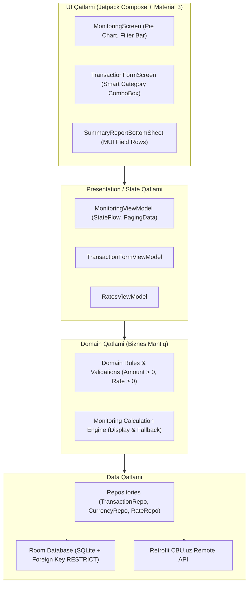
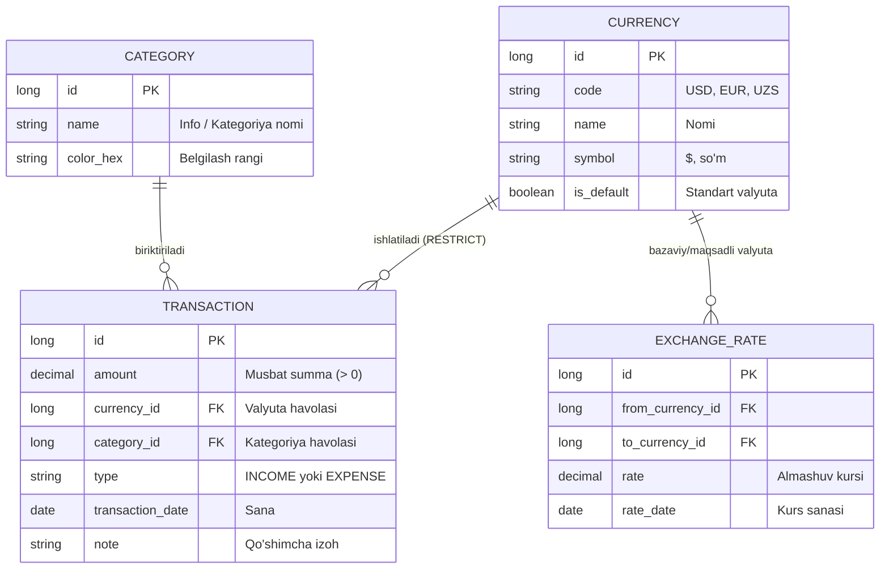

# 🏛️ Biznes Arxitekturasi (Business Architecture)
## Money Management App — Shaxsiy Moliya Boshqaruvi Tizimi

Ushbu hujjat **Money Management App** ilovasining biznes mantig‘i, asosiy domenga oid qoidalari (Domain Business Rules), ma’lumotlar yaxlitligi standartlari va arxitekturaviy tuzilishini batafsil yoritadi.

---

## 1. Loyihaning Maqsadi va Biznes Konsepsiyasi

Ilova foydalanuvchilarga o‘z shaxsiy mablag‘larini (kirim va chiqimlarini) turli xil xorijiy va mahalliy valyutalarda qulay, aniq va shaffof tarzda boshqarish imkoniyatini taqdim etadi.

Tizimning asosiy biznes talablari:
1. **Moliyaviy xatoliklarni oldini olish** (nol yoki manfiy summalar, noaniq kategoriyalarga yo‘l qo‘ymaslik).
2. **Dinamik va ko‘p valyutali hisob-kitob** (foydalanuvchi istalgan valyutani kiritishi va Markaziy Bank kurslari asosida konvertatsiya qila olishi).
3. **Ma’lumotlar yaxlitligi (Referential Integrity)** (tizimda ishlatilgan valyuta yoki kategoriyalar bexosdan o‘chib ketmasligi).
4. **Moslashuvchan hisobot (Fallback Monitoring)** (kursi mavjud bo‘lmagan eski tranzaksiyalarni yo‘qotmasdan, asosiy valyutada guruhlab ko‘rsatish).

---

## 2. Asosiy Biznes Qoidalari (Core Domain Rules)

### 2.1. Tranzaksiyalar Qoidalari
- **Summa (Amount):** 
  - Har doim musbat son bo‘lishi shart: `Amount > 0`.
  - `0` yoki manfiy sonlar (`-100`) qat’iyan qabul qilinmaydi va kiritish formasida bloklanadi.
- **Tranzaksiya turi (Transaction Type):**
  - Ikki tur mavjud: `INCOME` (Kirim) va `EXPENSE` (Chiqim).
- **Sana (Date):**
  - Tranzaksiya qaysi kunda sodir bo‘lganini ifodalaydi. Har bir tranzaksiya o‘z sanasidagi valyuta kursi bilan bog‘lanadi.

### 2.2. Info / Kategoriya Avtomatik To‘ldirish (Smart ComboBox)
- Foydalanuvchi yangi kategoriya/info nomini qo‘lda yozishi mumkin.
- Agar kiritilayotgan so‘z avval ishlatilgan bo‘lsa, u qidiruv natijasida avtomatik chiqib keladi (Autocomplete ComboBox).
- Bu foydalanuvchiga bir xil maqsaddagi xarajatlarni takroriy yozmasdan, bitta kategoriya ostida guruhlashga yordam beradi.

### 2.3. Valyutalarni Himoyalash Qoidasi (`RESTRICT` Constraint)
- Valyuta erkin yaratilishi mumkin (kod, to‘liq nom va belgi bilan).
- **Muhim cheklov:** Agar biror valyuta kamida 1 ta tranzaksiyada ishlatilgan bo‘lsa, uni bazadan o‘chirish taqiqlanadi.
- Ma’lumotlar bazasi darajasida Foreign Key `onDelete = ForeignKey.RESTRICT` mexanizmi qo‘llanilgan bo‘lib, u balans va audit ma’lumotlarining yo‘qolmasligini kafolatlaydi.

### 2.4. Valyuta Kurslari va Teskari Kurslar (Inverse & Cross Rates)
- **Markaziy Bank (CBU.uz) integratsiyasi:** Kurslar Markaziy Bankning rasmiy API'si orqali sana bo‘yicha avtomatik olinadi.
- **Teskari kurs qoidasi:** 
  $$\text{Rate}(B \to A) = \frac{1}{\text{Rate}(A \to B)}$$
  Masalan, agar `1 USD = 10 EUR` deb kiritilsa, tizim avtomatik ravishda `1 EUR = 0.1 USD` deb hisoblaydi va saqlaydi.
- **Sana bo‘yicha kurs mavjudligi:** Tranzaksiya amalga oshirilayotgan sanada tegishli valyutaning kursi bo‘lishi shart. Agar kurs bo‘lmasa, foydalanuvchiga dialog oynasi orqali kursni kiritish yoki CBU.uz dan avtomatik yuklash taklif etiladi.

---

## 3. Monitoring va Fallback Hisobot Mexanizmi

Ilovaning eng asosiy funksional afzalliklaridan biri bu **Ko‘p valyutali davriy hisobot** hisoblanadi.

### 3.1. Fallback Valyuta Ssenariysi
> **Biznes keys:** Foydalanuvchi 1 yillik barcha xarajatlarni ko‘rmoqchi. Ko‘rish valyutasi sifatida 3 kun oldin yaratilgan yangi valyuta (masalan, `KZT`) tanlandi. Lekin 3 kundan oldingi tranzaksiyalar vaqtida KZT valyutasi va uning kursi mavjud bo‘lmagan.

**Tizimning yechimi:**
Hisobot avtomatik ravishda ikkita mustaqil guruhga ajratiladi:
1. **Ko‘rish valyutasi guruhi (Display Group — KZT):**
   - KZT kursi mavjud bo‘lgan so‘nggi 3 kunlik tranzaksiyalar umumlashtiriladi.
   - Jami kirim, chiqim va balans KZTda aks etadi.
2. **Fallback guruhi (Fallback Group — UZS):**
   - KZT kursi yo‘q bo‘lgan qolgan barcha eski tranzaksiyalar tizimning asosiy fallback valyutasida (UZS) xisoblab beriladi.
   - Hech bir tranzaksiya e’tibordan chetda qolmaydi va moliyaviy hisobot 100% aniqlik bilan saqlanadi.

### 3.2. "Jami summa" Modal Ko‘rinishlari
- **Matnli ixcham ko‘rinish (MUI Input-Style):**
  - Mobil ekranlarda (masalan, Samsung Galaxy A04e) uzun raqamlar bir-biriga urilmasligi uchun **Label** tepada kichikroq shriftda, **Amount** esa uning tagida alohida qatorda joylashgan.
- **Aylana Diagramma (Pie Chart):**
  - Kirim va Chiqim foiz nisbatini vizual tarzda ko‘rsatuvchi interaktiv Jetpack Compose Canvas grafikasi.

---

## 4. Arxitekturaviy Qatlamlar (Clean Architecture + MVVM)

---

## 5. Ma’lumotlar Modeli (ERD Diagram)

---

## 6. Xulosa va Kengayuvchanlik (Scalability)

- **Modullilik:** Hilt Dependency Injection orqali har bir repozitoriy va komponent alohida ajratilgan. Kelajakda bank kartalari (SMS parsing) yoki boshqa xalqaro API'larni (masalan, Open Exchange Rates) ulash oson.
- **Ishonchlilik:** Barcha biznes qoidalari unit testlar (`DomainRulesTest.kt`) bilan to‘liq qoplangan.
- **Tezkorlik:** `Room` indekslari va `Paging 3` orqali ilovada o‘n minglab tranzaksiyalar mavjud bo‘lganda ham ekranlar hech qanday sekinlashuvlarsiz ishlaydi.
